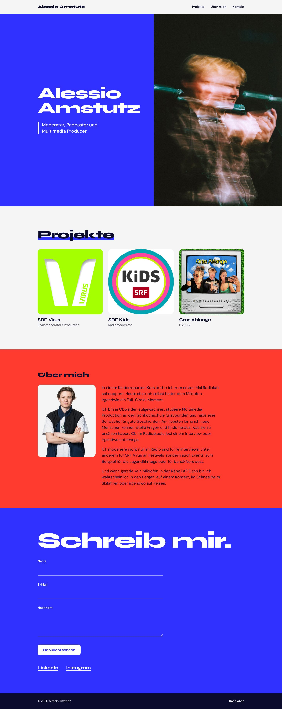
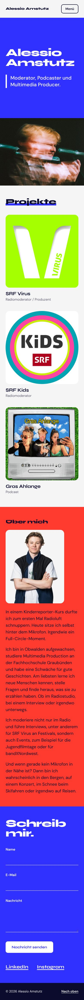

# Portfolio Alessio Amstutz

Meine persönliche Portfolio-Website. Sie entsteht im Modul **Interaktive Medien 5** (Herbstsemester 2026, Bachelor Multimedia Production, FH Graubünden).

**Online:** https://portfolio.im5.alessioamstutz.ch

## Projektidee

Ich arbeite als Moderator und Produzent bei SRF Virus, moderiere SRF Kids, bin Teil des Podcasts «Gras ahlange» und studiere Multimedia Production. Meine Arbeit ist verteilt: ein Teil läuft im Radio, ein Teil als Podcast, ein Teil in Studienprojekten. Wer mich buchen, anfragen oder einfach kennenlernen will, findet nirgends alles an einem Ort.

Dafür baue ich diese Seite. Sie soll in wenigen Sekunden zeigen, wer ich bin und was ich mache, und mich direkt erreichbar machen.

Mir war wichtig, dass die Seite **nicht wie eine Vorlage aussieht**. Viele Portfolios sind dunkel, überladen oder sehen alle gleich aus. Meine Seite ist bewusst schlicht, hell und jung, mit wenigen starken Farbflächen in Blau und Rot. Gleich oben steht ein bewusst unscharfes Foto von mir in Bewegung, weil mich die Leute zuerst als Person kennenlernen sollen. Ein scharfes Porträt folgt im Abschnitt «Über mich».

**Was Besucher:innen auf der Seite machen können:**

- Oben in der Navigation anklicken, wohin sie wollen. Die Seite scrollt dann zu «Projekte», «Über mich» oder «Kontakt».
- Meine Projekte als Kacheln ansehen. Drei sind sofort sichtbar, mit «Mehr Projekte» erscheinen die weiteren.
- Mir über das Kontaktformular schreiben. Die Nachricht kommt direkt in mein Postfach.
- Mich über LinkedIn und Instagram finden.

**Warum die Projekte in einer Datenbank liegen:**
Meine Projekte ändern sich laufend. Damit ich nicht jedes Mal den Code anpassen muss, stehen Titel, Kategorie, Kurztext, Bild, Farbe und Link in einer MySQL-Datenbank. Ein Klick auf eine Kachel öffnet ein Fenster mit dem Kurztext. Ich füge ein Projekt in phpMyAdmin hinzu, und es erscheint automatisch auf der Seite.

## Technologien

- **HTML, CSS, JavaScript** für Aufbau, Gestaltung und Interaktion (mobiles Menü, Scroll-Navigation, Nachladen der Projekte)
- **PHP und MySQL** für die Projekte und das Kontaktformular
- **Infomaniak** als Hosting

## Ordnerstruktur

```
index.html               die Seite
css/style.css            Gestaltung
js/main.js               Menü, Projekte laden, Formular
api/projects.php         liefert die Projekte aus der Datenbank
api/contact.php          speichert die Nachricht und schickt mir eine Mail
api/db.php               Verbindung zur Datenbank
api/config.example.php   Vorlage für die Zugangsdaten
sql/schema.sql           Datenbank-Tabellen mit Beispielprojekten
sql/update-beschreibung.sql  fügt die Spalte «description» hinzu (für bestehende Datenbanken)
sql/texte-projekte.sql   setzt die Kurztexte der Projekte
screenshots/             Bilder für dieses README
img/, fonts/             Bilder und Schriften
```

## Setup

1. Repository herunterladen und in den Webordner von MAMP oder XAMPP legen.
2. In phpMyAdmin eine Datenbank erstellen und `sql/schema.sql` importieren. Optional danach `sql/texte-projekte.sql` für die Kurztexte (ersetzt die Beispielprojekte nicht, passt nur passende Titel an).
3. `api/config.example.php` kopieren, die Kopie `api/config.php` nennen und die eigenen Datenbank-Zugangsdaten eintragen.
4. Im Browser öffnen, zum Beispiel `http://localhost:8888/portfolio-alessio/`.

Die `config.php` mit dem Passwort ist nicht im Repository (`.gitignore`).

## Screenshots

Desktop:



Mobil:



## Learnings

- Lokal (MAMP) und auf dem Hosting sind Datenbank-Host, Port und Benutzer verschieden. Deshalb hat jede Umgebung ihre eigene `config.php`.
- Auf dem Server ist die Schreibweise von Dateinamen wichtig. Umlaute und Leerzeichen in Bildnamen machen Bilder kaputt.
- Für Umlaute in der Datenbank braucht es überall `utf8mb4`.
- Browser speichern CSS und JavaScript zwischen. Nach dem Hochladen sieht man deshalb manchmal noch die alte Version (Hard-Reload oder privates Fenster hilft).
- Fehlt ein Kurztext in der Datenbank, springt eine Ersatz-Liste in `js/main.js` ein, damit das Projekt-Fenster nie leer ist.

## Schwierigkeiten

- Die Datenbankverbindung funktionierte lokal, aber nicht auf dem Hosting (falsche Zugangsdaten).
- Bilder wurden nicht angezeigt (falsche Pfade, fehlende Endungen, Umlaute im Namen).
- E-Mails lassen sich lokal nicht testen, weil MAMP keinen Mailserver hat.

## Ressourcen

- [MDN Web Docs](https://developer.mozilla.org/de/)
- [PHP-Handbuch zu PDO](https://www.php.net/manual/de/book.pdo.php)
- Schriften [Syne](https://fonts.google.com/specimen/Syne) und [DM Sans](https://fonts.google.com/specimen/DM+Sans) (Lizenzen im Ordner `fonts/`)
- Fotos: eigene Aufnahmen; Projektbilder von SRF, Din16erTV und «Gras ahlange»
- Entwurf in Figma, Hilfe beim Programmieren durch Claude (Anthropic)
